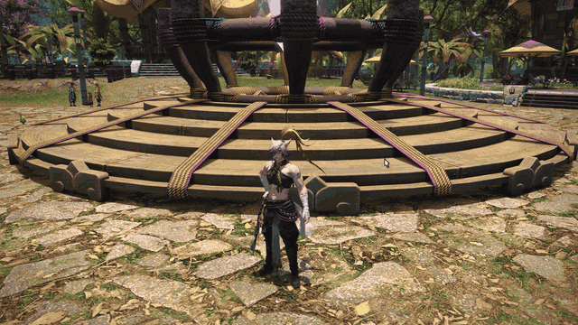

<p align="center"></p>

# Glance

**A little eye contact. A little personality.**

Glance brings your character's head and eyes toward the camera when you zoom in and stand still. Add an occasional wink, choose a personality mood, or build your own selection of unlocked emotes.



[Get Glance](https://github.com/khamass/Glance/releases/latest) · [Report a bug](https://github.com/khamass/Glance/issues/new/choose) · [Release notes](RELEASE-NOTES.md)

## Your close-up, your character

- **Meet their gaze.** Head and eye tracking follows the camera during idle close-ups, with adjustable responsiveness.
- **Give them personality.** Choose from 18 menu options, including Shy, Confident, Cheerful, Mischievous and Custom. Search the installed game's catalog of unlocked performance emotes, copy a mood into Custom, and adjust frequency and timing.
- **Frame the moment.** Optional extended close-up distance, camera-angle controls and fine zoom steps blend smoothly as you enter and leave close-up range.

Gaze itself does not turn the body. Body-animation emotes are a separate option; turn **Allow body animations** off for face-focused close-ups.

## Install

Requires Final Fantasy XIV with XIVLauncher/Dalamud. Glance targets **Dalamud API 15** and is distributed through its own custom repository.

1. Open `/xlsettings` → **Experimental** → **Custom Plugin Repositories**.
2. Add this URL, enable the repository and save:

   ```text
   https://raw.githubusercontent.com/khamass/Glance/main/repo.json
   ```

3. Open `/xlplugins`, search for **Glance**, and install.
4. Type `/glance`, stand still, and zoom in. The default gaze activation distance is 3 yalms.

For updates, use **Update plugins** in `/xlplugins`. Disable any local development copy before installing the repository version.

## Find your vibe

| Mood | Selection |
| --- | --- |
| Wink (classic) | Wink followed by a smile |
| Playful | Wink / pucker up |
| Friendly | Smile / fake smile |
| Dramatic | Amazed / taunt |
| Expressive | Joy / pose, including body motions |
| Shy, Confident, Cheerful, Mischievous | Curated themed emotes |
| Thoughtful, Affectionate, Melancholic, Theatrical | Curated themed emotes |
| Celebratory, Dance party | Celebrations and dances |
| Facial shuffle | Known unlocked facial expressions |
| Custom | Search and select unlocked performance emotes |
| Off | Gaze only |

Available choices depend on the character's unlocks and the body-animation toggle. Missing or locked entries are skipped; an empty pool keeps gaze active without sending an emote. Random selection avoids immediate repeats where possible. Sitting, changing pose and other state controls are excluded from personality performances.

By default, every fourth zoom-in or distinct camera turn can queue an expression after the camera settles for two seconds. Adjust both settings in `/glance`. A continuous camera drag counts as one turn. New catalog body-emote cooldowns support up to 30 seconds; facial holds support up to five seconds.

## Camera controls

**Extended close-up** is optional and off by default. It allows a closest distance of 0.10–1.50 yalms (default 0.50) and bypasses your character's proximity hiding in third person. Very small distances can put the camera inside the model; increase the minimum if geometry clips.

- **Fine close-up zoom:** choose a delta from 0.01–1.00 (default 0.10). Zoom speed blends across the 0.75 yalms before **Close-up distance**.
- **Close-up camera angle:** temporarily use an angle from 0–100 (default 50), with a separate activation distance.
- **Close-up transition time:** adjust angle easing from 0.10–1.50 seconds (default 0.35). Zooming out blends back and restores the captured angle.

Normal activity pauses the relevant controls: combat, PvP, mounts, casting, death, transitions, cutscenes, occupied events, group pose, first person, lock-on and alternate cameras. Movement pauses gaze and expression triggers. Disabling or unloading restores owned camera limits and the captured angle immediately.

## Compatibility and animation notes

- Other camera plugins can overwrite zoom or angle controls. If framing jumps, compare with those controls disabled in the other plugin. Glance's conflict message is a diagnostic, not proof of a particular culprit.
- Body emotes can move or turn the character, need a target, or loop. `/straightface` and hold timers reset the face only. Move manually to stop a looping body motion.
- The close-up angle temporarily changes the actual Character Configuration setting. A crash or forced termination during close-up may leave that temporary value set; restore your preferred angle in Character Configuration if needed.
- Game updates can require a compatible Glance/Dalamud build. Compilation and automated tests do not establish compatibility with every game state or plugin combination.
- Glance is not an official Dalamud repository listing. Extended camera bounds fall outside the official repository's [publishing restrictions](https://dalamud.dev/plugin-publishing/restrictions/).

## Feedback

[Report a bug](https://github.com/khamass/Glance/issues/new/choose) with the Glance version, reproduction steps, expected/actual behavior and relevant camera plugins. Screenshots or short clips help with camera and animation issues.

[Suggest a feature](https://github.com/khamass/Glance/issues/new/choose) with the character moment or workflow you want to improve.

## Build and contribute

Requires .NET 10 and Dalamud development libraries from XIVLauncher.

```powershell
dotnet build Glance.csproj -c Release
dotnet run --project tests/Glance.Checks.csproj -c Release
./scripts/New-Release.ps1
```

For a different library location, pass `-p:DalamudLibPath=C:\path\to\dev` when building. The package allowlist contains only Glance.dll, Glance.json, images/icon.png and LICENSE; game libraries and user settings are not included.

`main` requires pull requests and blocks force pushes/deletion. See [publishing instructions](PUBLISHING.md) for the release workflow and [release notes](RELEASE-NOTES.md) for version history.

## Credits

Created by **Macki** ([khamass](https://github.com/khamass)). Source was developed with substantial AI assistance, with human design direction and in-game feedback. The icon was generated with AI assistance. [MIT License](LICENSE).

