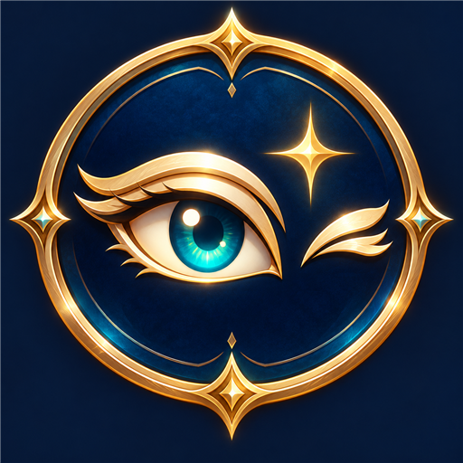

# Glance

**A little eye contact. A little personality.**

A Dalamud plugin for Final Fantasy XIV that activates the game's `/facecamera` gaze when you zoom in and stand still. Add facial expressions, opt into Joy/Pose body motions, or keep gaze only. Gaze tracking itself does not rotate the body.

**Stable release: v1.0.0.** [Download the latest release](https://github.com/khamass/Glance/releases/latest).

## Repository installation

Add this URL in `/xlsettings` → Experimental → Custom Plugin Repositories:

`https://raw.githubusercontent.com/khamass/Glance/main/repo.json`

Save, open `/xlplugins`, and install Glance. Disable any development copy first. See [publishing instructions](PUBLISHING.md) for the release checklist.

## Credits

Created by **Macki** ([khamass](https://github.com/khamass)). Source was developed with substantial AI assistance, with human design direction and in-game feedback. The icon was generated with AI assistance. Distributed under the [MIT License](LICENSE).

## Install the development build

1. Build with `dotnet build Glance.csproj -c Release` (requires .NET 10 and Dalamud development libraries from XIVLauncher).
2. In FFXIV, open `/xlsettings`, go to Experimental, and add the full path to `bin\Release\net10.0-windows\Glance.dll` under Dev Plugin Locations.
3. Open `/xlplugins`, find Glance under Dev Tools, and enable it.
4. Type `/glance`. Stand still, then zoom within the default 3-yalm activation distance. Use **Use current zoom** to choose your own threshold.

`/glance on`, `/glance off`, and `/glance toggle` control the feature without opening settings.

If upgrading from the previous name, disable the old development plugin and replace its Dev Plugin Location with the new `Glance.dll` path. Glance imports the previous saved settings on first load when it has no settings file of its own.

## Behavior

### Personality settings (v0.3.1)

Open `/glance` and choose a mood:

| Mood | Expressions |
| --- | --- |
| Wink (classic, default) | Wink, followed by a smile |
| Playful | Wink, pucker up |
| Friendly | Smile, fake smile |
| Dramatic | Amazed, taunt |
| Expressive | Joy, pose (includes body motions) |
| Custom | Any combination of the eight choices |
| Off | Camera gaze only; no automatic facial emotes |

Pools choose randomly and avoid consecutive repeats when more than one expression is selected. An empty custom pool behaves like Off. Wink remains the default for existing settings.

Version 0.3.1 adds **Expressive**, choosing between `/joy motion` and `/pose motion`. Both are also available in Custom. These include body animations that finish naturally; `/straightface` clears facial expressions only and does not stop a body animation. Their default cleanup hold is 4 seconds each. Existing mood IDs and saved selections are preserved.

Set frequency from every 1 to 10 zoom-ins or distinct camera turns (default 4). The counters remain independent. Set the camera-settle wait from 0 to 5 seconds (default 2). Under **Expression durations**, adjust each selected expression's hold from 0.1 to 5 seconds. Defaults: wink 0.3s, smile 2s, fake smile 1.8s, pucker up 1.4s, amazed 2s, taunt 1.6s.

Wink retains its smile transition and one bounded smile retry. Other expressions return directly to `/straightface`. Neutral cleanup gets one bounded retry. Expression sequences never overlap, discard delayed steps when the actor changes, and clear on zoom-out, pause, or unload. Off does not issue a zoom-out emote unless an existing Glance expression still needs cleanup.

### Gaze and trigger behavior

- Zooming out beyond the close-up exit buffer sends `/straightface motion` and cancels pending wink/smile actions, even if movement already paused gaze. A single follow-up 0.65 seconds later covers an expression command rejected during the emote lock.

- Version 0.1.12 keeps the 0.3-second smile attempt and repeats it once 0.35 seconds later, because text-command dispatch does not confirm that the game accepted a facial-expression change. The straight-face timer restarts from that follow-up. This is a bounded fallback, not confirmation of the game's animation-lock timing; verify in game.

- Every fourth distinct camera turn can also queue the wink sequence while close and idle. A turn needs at least 10 degrees of accumulated yaw/pitch travel and a 0.3-second pause to finish. A continuous drag counts once. Zoom and turn counters are independent; simultaneous triggers merge into one pending wink. Both zooming and rotation must settle for 2 seconds before the wink, and expressions cannot overlap. Incomplete turns are discarded when gaze pauses.

- Every fourth eligible zoom-in waits until the camera zoom distance has stopped changing for 2 seconds, then sends `/wink motion`, followed 0.3 seconds later by `/smile motion`, then another 2 seconds later by `/straightface motion`. Further zooming restarts the wait. The `motion` suffix avoids emote chat messages. Pausing cancels a queued wink; pausing or unloading completes pending expression cleanup immediately for the same logged-in actor. Zoom out beyond the exit buffer to count another visit; moving or changing settings while close does not count again. The counter resets when the plugin reloads.
- Version 0.1.6 captures the native gaze vector immediately on activation to avoid missing its camera match during orbiting. After a wink or smile it checks once for cancelled plugin-owned gaze and restores it if needed, without toggling an active gaze off.

- Native `/facecamera` head and eye gaze. The game controls its animation and tracking.
- Version 0.1.10 increases target responsiveness another 50% (default 45); saved settings are upgraded automatically. Adjust **Gaze responsiveness** from 5 to 90 for slower or faster tracking. The native head animation may impose its own speed limit.
- Keeps plugin-owned gaze enabled during camera rotation. Attempts to identify the native camera-vector representation from the value captured by the game, then updates that vector with smoothing. If no representation matches, holds the original gaze and displays a diagnostic in settings. Manually enabled gaze is left alone.
- Resumes after 0.4 seconds standing still. Stops when movement is observed.
- A 0.35-yalm exit buffer prevents flickering at the zoom threshold.
- Pauses for combat, PvP, mounts, casting, death, area transitions, cutscenes, occupied event states, group pose, first person, lock-on, and alternate cameras.
- Sends `/facecamera` once on entering range and again when leaving, pausing, disabling, or unloading, only if Glance enabled the gaze and it is still active.
- Preserves gaze that was already enabled manually. If you cancel it manually while zoomed in, zoom out and back in to reactivate it.
- Does not write portrait camera-follow fields or body rotation.

## Build and verification

The project references the installed Dalamud libraries without copying them into the output. For a different location use `dotnet build -c Release -p:DalamudLibPath=C:\path\to\dev`.

Run the standalone math checks with `dotnet run --project tests/Glance.Checks.csproj -c Release`.

In-game acceptance checks: confirm head and eye tracking from the front and sides, unchanged body orientation, smooth orbit tracking, release on walking, reactivation after stopping, threshold behavior, first person exclusion, logout/login, zone changes, combat suspension, and clean plugin unload. Confirm normal targeting gaze resumes after disabling.

Version 0.1.3 removes the jitter-producing off/on refresh cycle. It uses `/facecamera` for activation and cancellation only, with experimental direct camera-vector updates while active. The settings show whether the native gaze flag is active or the vector representation is unrecognized. Compilation does not establish live game compatibility; verify in game, including continuous orbiting, large rotations, and movement. Group pose clones are not implemented. Game updates may require rebuilding against updated Dalamud/FFXIVClientStructs libraries.

## References

- [Dalamud plugin development](https://dalamud.dev/faq/getting-started/)
- [FFXIVClientStructs](https://github.com/aers/FFXIVClientStructs)

# Extended close-up (v0.4.0)

In `/glance`, enable **Extended close-up**, then scroll in. **Closest camera distance** controls the closest allowed third-person distance (0.10–1.50 yalms, default 0.50); smaller values allow tighter close-ups. **Close-up distance** remains the gaze activation threshold. Your own character bypasses the camera's proximity-hiding check during close-ups. Other characters retain normal visibility rules.

The option is off by default and restores the previous camera minimum when disabled or unloaded. It also pauses during combat, PvP, mounts, casting, cutscenes, transitions, group pose and occupied activity. First person remains a separate mode: scroll back out before changing perspective. Very small distances may put the camera inside the face; increase the slider if geometry clips. Inside the extended zoom range, Glance temporarily uses 3rd Person Camera Angle 50 and restores your Character Configuration angle when zooming out (with a 0.05-yalm exit margin). This is a live camera override; the saved game setting is unchanged. Maximum zoom-out distance stays unchanged.

Build and automated camera-limit restoration checks pass; rendering and scrolling need in-game testing. Extended camera bounds are for the custom-repository release and are excluded by the [official Dalamud publishing restrictions](https://dalamud.dev/plugin-publishing/restrictions/).

## Camera angle controls (v0.4.2)

Under Extended close-up, toggle **Override close-up camera angle**, choose an angle from 0–100, and set **Angle activation distance** independently of other plugins' camera limits. Defaults are 50 and 1.50 yalms. Zooming out releases the live override without changing saved game settings. The UI shows active/waiting status and a possible-conflict message when repeated external angle changes are observed. This diagnostic cannot name a plugin or guarantee compatibility; compare with other camera plugins' angle controls disabled.

## Camera framing fix (v0.4.3)

The close-up angle now temporarily changes the game's actual Character Configuration setting through UiControl TiltOffset. Glance captures the original configured value once and restores it on zoom-out or normal cleanup. Earlier descriptions of a live-only override apply to v0.4.1/0.4.2. A crash or forced termination may leave the temporary angle set. The conflict diagnostic now observes configuration writes, not native interpolation. Other camera plugins can still interfere; compare with their angle controls disabled.

## Personality catalog (v0.5.0)

The mood menu now offers 18 choices. New themed moods are Shy, Confident, Cheerful, Mischievous, Thoughtful, Affectionate, Melancholic, Theatrical, Celebratory, Dance party and Facial shuffle. The original pairs and saved settings stay compatible.

Choose **Custom** to search performance emotes from the installed game's catalog by name or slash command. Only unlocked emotes are shown and selected. New unlocks refresh within a second. State controls (sitting, changing pose, camera gaze and neutral reset) are excluded. **Copy this mood to Custom** starts an editable selection from the current mood's available emotes. New selections use game row IDs, so they are not limited by the old eight-choice bit mask.

**Allow body animations** filters all pools. Turn it off for face-focused close-ups. Known facial commands are classified as facial; other catalog commands conservatively count as body motions. **Facial shuffle** randomly picks among known unlocked facial expressions. Empty pools leave gaze active without sending an emote.

New catalog body animations default to an eight-second cooldown, configurable up to 30 seconds; facial holds go up to five seconds. Existing Joy/Pose timings are preserved. Some body emotes loop, turn/move the character, or require targets and other conditions. Holds and /straightface reset the face only; move manually to stop looping motions. Commands use motion-only output and never bypass unlocks. Unlock status does not guarantee usability in every game context.

Game-data loading, localized commands, unlock refresh and actual animations need in-game testing. The catalog is loaded from game data instead of a hard-coded count, so the available count depends on the installed game and character unlocks.

## Fine close-up zoom (v0.5.1)

Under **Extended close-up**, enable **Fine close-up zoom** and adjust **Close-up zoom delta** (0.01–1.00, default 0.10). Smaller values give finer zoom steps. It applies in both directions within **Close-up distance**, independently of the angle activation distance. Outside that range, or when the feature is disabled/paused, the original camera zoom speed is used. Closest camera distance still sets the final zoom limit. Other camera plugins can affect the result; scrolling and input-device behavior require in-game testing.

## Smooth transitions (v0.5.2)

Zoom speed blends over the 0.75 yalms before **Close-up distance**. Camera angle blends over the 0.75 yalms before **Angle activation distance** and eases over time; set **Close-up transition time** (0.10–1.50 seconds, default 0.35) to adjust the angle response. Zooming out reverses the blend and then restores the exact captured angle. Disabling or pausing restores immediately. This replaces the abrupt switches and the previous angle exit margin. In-game feel and other-plugin compatibility require testing.
